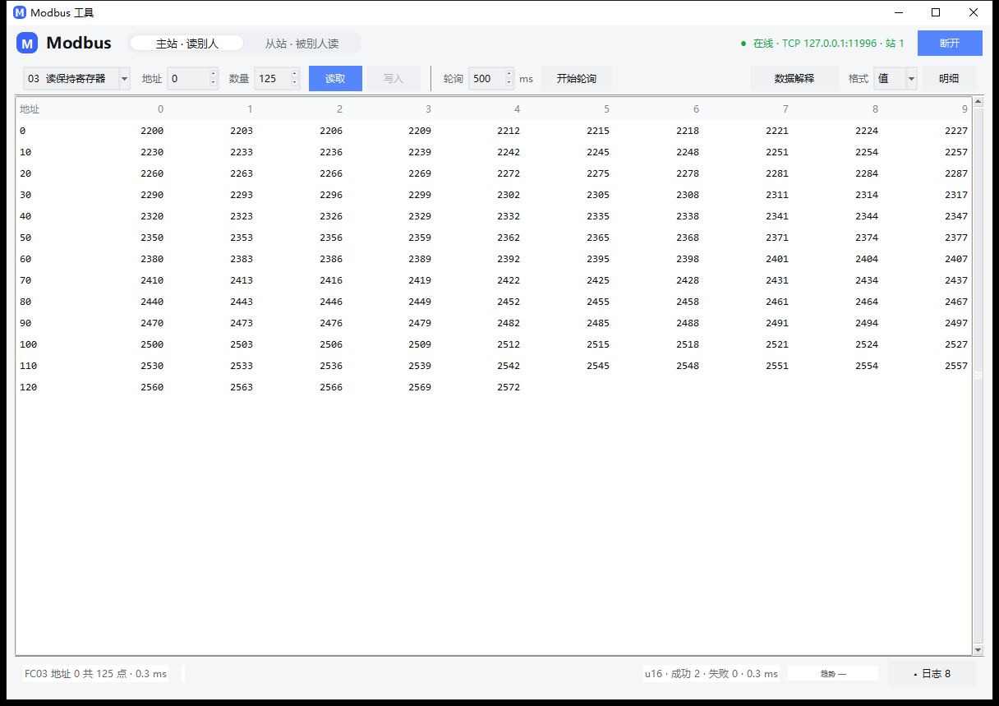
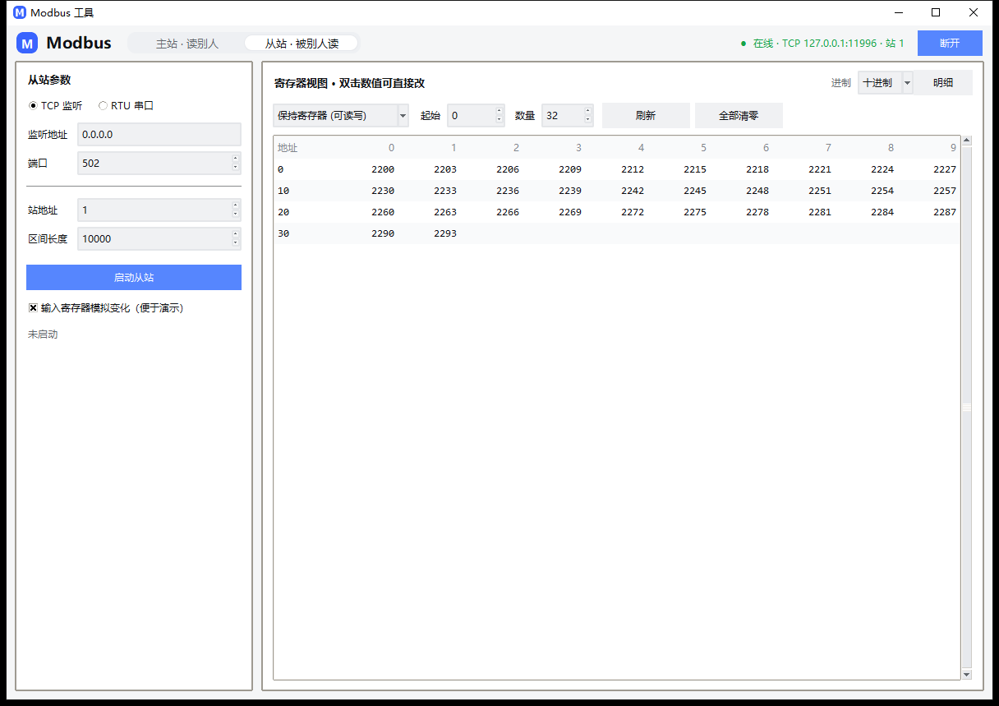

# Modbus 工具

主从一体、TCP / RTU 双模的轻量级 Modbus 调试工具。界面是 Tkinter 单窗口桌面程序，
协议内核只用标准库 —— 只有 RTU 串口模式需要 `pyserial`。

读到的寄存器能按 9 种数据类型（含 ASCII 字符串）× 4 种字节序解释，带缩放、单位和 PLC 地址记法；
每次收发的原始报文都能看到。这两件事决定了它能不能当日常主力工具用。



> 网页版（`web.py` + `webui/`）已下线，不再维护。相关功能里真正与界面无关的部分
> 保留在 `modbus_tool/core.py`，见文末「待移植」。

## 能力一览

| 功能码 | 名称 | 主站 | 从站 |
|---|---|---|---|
| 01 | 读线圈 | ✅ | ✅ |
| 02 | 读离散输入 | ✅ | ✅ |
| 03 | 读保持寄存器 | ✅ | ✅ |
| 04 | 读输入寄存器 | ✅ | ✅ |
| 05 | 写单线圈 | ✅ | ✅ |
| 06 | 写单寄存器 | ✅ | ✅ |
| 0F | 写多线圈 | ✅ | ✅ |
| 10 | 写多寄存器 | ✅ | ✅ |
| 17 | 读写多寄存器 | 内核支持 | ✅ |
| 2B | 读设备标识 | 内核支持（TCP / RTU） | ✅ |

异常码按规范生成与解析，主站收到异常会原样上报，不会当成「读到 0」。界面里把异常码翻成人话
（「地址或数量超出从站范围」），不用去查表。

## 数据类型与地址

寄存器只有 16 位无符号整数，但设备里装的常常是别的东西。支持的解释方式：

| 类型 | 占用 | 说明 |
|---|---|---|
| `uint16` / `int16` | 1 寄存器 | 默认，最常用 |
| `uint32` / `int32` | 2 寄存器 | 累计量、电度 |
| `float32` | 2 寄存器 | 温度、功率、流量 —— 现场最常踩坑的地方 |
| `uint64` / `int64` / `float64` | 4 寄存器 | 少见但存在 |
| `ascii` | 1 寄存器 = **2 个字符** | 设备型号、序列号、版本号这类字符串 |

**字节序**四种，对应「寄存器之间的字」和「寄存器内部的字节」两级排列：

| | 字节排列 | 典型来源 |
|---|---|---|
| `ABCD` | 00 01 02 03 | 标准大端 |
| `BADC` | 01 00 03 02 | 部分电表 |
| `CDAB` | 02 03 00 01 | 大量 PLC 的默认 |
| `DCBA` | 03 02 01 00 | 完全小端 |

同一个 `220.5`，四种字节序对应四组完全不同的寄存器值。手册说 float32 却读出天文数字，
九成是这里选错了。

**ASCII 字符串**：一个寄存器装两个字符，`0x4142` 就是 `AB`。读出来是这样：

```
地址   0     1     2     3     4     5     6     7
0     MO    DB    US    -T    ES    T-    00    01      ← 横读是 MODBUS-TEST-0001
状态栏  "MODBUS-TEST-0001"                              ← 整串直接给出来
```

- **不可打印字节显示成 `·`**（比如字符串后面的 `0x00` 填充）。特意不用 `.` ——
  句点是合法 ASCII 字符，用句点做占位会分不清「这里是 0x00」还是「这里真是个句点」。
- **字节序对 ASCII 仍然有效**：它决定一个寄存器里两个字符谁在前（`ABCD` → `AB`，
  `BADC` → `BA`）。所以这个类型下字节序下拉不会置灰。
- **写入**：在「值」里填整串，比如 `MODBUS-TEST-0001`。字符串里可以有逗号，不会像数值
  那样被切开；奇数长度自动补一个 `0x00`（`HELLO` → 3 个寄存器）。
- **非 ASCII 字符会被拒绝**，不会静默写成一堆问号 —— 设备里存了乱码而界面看不出来是最糟的。
  中文型号名需要设备约定 GBK 之类的编码，那个本工具不支持。

**改一格要小心**：双击某一格改两个字符时，格里的 `·` 是占位符，回车提交会**保留原字节**，
不会把 `0x00` 写成真字符。想改整串请用工具条的「写入」，地址和长度都看得见。

**负数**：寄存器本身是 16 位无符号，负数按补码存 —— `-5` 就是 `0xFFFB`（65531）。
主站读取时把「类型」选成 `int16`（32 位选 `int32`），显示的才是 `-5`；
用 `uint16` 读同一个寄存器会显示 `65531`，这不是错，是解释方式不同。
写入时也一样：填 `-5` 要配 `int16`，配 `uint16` 会直接告诉你「要写负数请把类型改成 int16」。

**缩放**：`显示值 = 原始值 × 系数`。比如原始 2200 配系数 0.1 显示 `220.0`，单位填 `℃` 就是
`220.0 ℃`。读的时候乘，写的时候自动除回去。

**地址记法**：协议地址从 0 开始，PLC 地址从 40001 开始（手册一般写后者）。
勾上「PLC 地址」后直接填 40001，程序自己换成协议地址 0；填 40108 换成 107
（差的是那个 1，不是 108）。地址填错区域（比如给「读保持寄存器」填 30001）会直接报错。

## 界面

主站页只有三样东西：**一条工具条、一张铺满的表格、一条状态栏**。

```
┌ 顶栏 ── Modbus | 主站·从站 | ● 在线 · TCP…:5020 · 站 1 | 连接/断开 ┐
│ 工具条 ── 功能码 地址 数量 [读取][写入] 轮询 500ms [开始轮询] … 数据解释 格式 明细 │
│                                                                  │
│                        数 据 表 格（窗口 80%）                    │
│                                                                  │
└ 状态栏 ── FC03 地址 0 共 125 点 · 0.4ms | u16 · 成功 1 · 失败 0  ▴日志 5 ┘
```

这样排是为了让数据占满视野：窗口 1200×820 下，表格实测 **1166×681，占窗口面积 80.7%**、
高度 83%；最小窗口 1040×680 时仍有 77%。链路参数、数据解释、日志都不再和表格抢地方：

- **连接参数**（主机/端口或串口/波特率/数据位/校验/停止位 + 站地址/超时/重试）只在**没连上**时
  展开成一条；连上就收起，把高度还给表格。要改就点「断开」。
- **数据解释**（类型/字节序/系数/单位 + 地址记法）收进弹层，工具条上的「数据解释」打开。
  当前用的是哪套解释，状态栏里常驻一句话回声：`u16 · CDAB · ×0.1 ℃`。
  名字不叫「显示设置」是有意的 —— 里面没有一项是界面外观，全都是「这串 16 位数字是什么含义」；
  而工具条上的「格式」（值/HEX/BIN）管的是显示成什么形式，两个词分工不同。
  地址记法（十进制 / 十六进制 / PLC 记法）是**三选一**，和 Modbus Poll 的
  `Base 1 / Base 0` 一个思路：它们本质互斥，做成两个复选框会出现「两个都勾上、
  十六进制却不生效」的假开关。
- **日志**收起成状态栏右侧一个按钮（`▴ 日志 5`），点开是覆盖在表格底部的浮层 —— 高度不变，
  表格不缩。浮层停状态栏上方，看报文时 FC、地址、错误数照样看得到。

具体用法：

- **读**：选功能码、起始地址、数量 → 「读取」。结果默认是 **Modbus Poll 式网格**
  （行头是起始地址，列宽平分窗口，二进制模式自动降为每行 4 格），
  点「明细」切成逐行视图，地址 / 值 / HEX / BIN 四列常驻。「格式」在 值 / HEX / BIN 之间切换。
- **地址对齐**：网格的行首**总是对齐到每行格数的整数倍**，所以「行首地址 + 列头 = 格子地址」，
  列头就是地址的末位，不用心算。十进制每行 10 格（行首 0 / 10 / 20…，列头 0–9）；
  地址记法选「十六进制」后每行 16 格（行首 0x0000 / 0x0010…，列头 0–F）。
  起始填 5、数量 31，第一行前 5 格直接留空（这段没读），`5` 就落在列头 **5** 下面。
  行首地址不再补零，主站和从站写法一致。
- **光标读数**：鼠标扫过任意格子，状态栏左侧实时给出 `7 = 2215`（地址 = 值），
  这是"这一格是哪个寄存器"的兜底答案。
- **写**：切到写功能码，「值」输入框才出现（读的时候不占地方），填地址和值（逗号分隔）。
  写入值按当前类型解释，写 `3.14` 配 float32 会自动编码成两个寄存器。
- **写几个寄存器（FC16 最容易搞混的地方）**：`填了几个值` ≠ `写了几个寄存器` —— 一个
  float32 占 2 个、float64 占 4 个。四个地方都会告诉你是几个：
  1. **按按钮之前**，工具条「值」后面就有 `→ 6 个寄存器`，随输入实时变；
  2. **写完之后**，状态栏是 `已写入 6 个寄存器（12 字节） · 已回读确认 · 0.2 ms`；
  3. **表格上**，刚写过的格子会被框起来 2.6 秒 —— 数框了几个就知道写到了哪儿
     （「值」格式下一格是一个值，HEX 格式下一格是一个寄存器）；
  4. **报文日志**里，TX 那一帧下面跟一行 `└ FC16 写多寄存器 · 数量 6 个寄存器（12 字节）· 起始 4`，
     数字是从帧里读的，不是从输入框猜的。字节数对不上数量时还会标 ⚠。
  写完自动用对应的读功能码回读一次（保持原来的读取范围，不会把一屏 30 格缩成 6 格），
  确认数据真的落到了从站 —— 而不是只告诉你「发送成功」。
- **改（就地写）**：**双击表格里的任意数值**，直接在那一格上改。写的就是这个格子对应的地址
  （保持寄存器 FC03），回车发出，Esc 或点别处取消 —— 不会因为手滑写进设备。
  跨两个寄存器的类型（float32 / int32 / uint32）改一格就写整段，按当前字节序和系数编码；
  HEX/BIN 格式下改的是原始寄存器值。写完自动整屏回读确认。
  线圈（FC01）双击是取反，离散输入（FC02）和输入寄存器（FC04）是只读的，会直接告诉你。
- **改（从站）**：从站页双击「值」改模拟器内存，**负数直接填**（`-5` 按补码存成 `0xFFFB`，
  提示栏同时给出两种写法）。从站表格的「进制」下拉里有「有符号」，切过去就看到
  `-5 / -32768`。从站网格和主站用同一套行首对齐规则，两边对照同一个地址时行列位置一致。
- **看变化**：轮询时值一变化，那一行会淡蓝高亮 900ms。点住任意一格，状态栏的迷你趋势条
  就开始画这格的最近 120 次读数 —— 一眼看出是在抖、在爬，还是死了。
- **看统计**：状态栏右侧常驻 `u16 · 成功 128 · 失败 3 · 0.8 ms`。
  失败数包含重试 —— 它比成功数大，通常意味着链路在抖。
- **看报文**：点状态栏的「▴ 日志」展开，每次收发的完整帧都在 —— 毫秒时间戳、TX/RX 着色、
  字节数、十六进制。可以「暂停」（只停刷新，报文照收）和「导出…」；往上翻旧帧不会被拽回底部。
- **链路状态**：顶栏是 `● 在线 · TCP 127.0.0.1:15040 · 站 1`。连续读失败会变成
  `● 无响应 N 次`，三次以上转 `● 链路中断`，读到一次就自动回绿。
- **模拟器**：从站页起一个 TCP / RTU 从站，主站连过来自测，全程不需要真实设备。
  正在跑的时候，页签上有个绿点。

### 快捷键

| 键 | 作用 |
|---|---|
| `F5` / `Ctrl+Enter` | 按当前功能码执行一次（读或写） |
| `Ctrl+1` / `Ctrl+2` | 主站页 / 从站页 |
| `F6` | 两页之间来回切 |
| `Esc` | 停止轮询 |
| `Ctrl+L` | 清空日志 |
| 右键 | 复制该格 / 复制整表（TSV，可直接粘进 Excel） |
| 双击数值 | 就地改写这个寄存器（回车提交，Esc 取消） |
| 状态栏「▴ 日志」 | 展开/收起报文浮层 |



从站页的演示数据可以让输入寄存器自己动，用来联调趋势与报警；更细的信号（正弦/斜坡/方波/随机）
和故障注入目前在 core 层，界面入口待移植。

## 运行

需要 Python 3.9 以上；RTU 模式需要 `pip install pyserial`（或 `pip install -e ".[rtu]"`）。

```bash
run_tk.bat                 # 双击启动（自动找一个带 tkinter 的解释器）
python modbus.py           # 同上
python modbus.py read --tcp 192.168.1.10 --fc 3 --addr 0 --count 4 \
    --type float32 --byteorder CDAB --unit-label ℃
python modbus.py read --tcp 192.168.1.10 --fc 3 --addr 40001 --count 4 --plc
python modbus.py serve --tcp 0.0.0.0:5020 --unit 1 --init 100,200,300
```

`run_tk.bat` 会自己找一个能 `import tkinter` 的解释器（先扫 uv 装的，再扫 PATH 上的
python / py）；找到的不对就用 `MODBUS_PYTHON` 环境变量指定。

## 目录结构

```
modbus/
├── modbus.py                 统一入口（默认界面 / CLI）
├── run_tk.bat                启动器（自动找带 tkinter 的解释器）
├── modbus_tool/
│   ├── crc.py                CRC16（查表法）
│   ├── pdu.py                功能码编解码 + 数量上限表，与传输无关
│   ├── codec.py              寄存器值 ↔ 物理量（9 类型 × 4 字节序 + 缩放）、hex/bin 格式化
│   ├── addressing.py         协议地址 ↔ PLC 地址，统一的地址解析/显示
│   ├── parsing.py            用户输入解析（全角归一化、整数进制、写值切分）
│   ├── datastore.py          从站四个寄存器区 + 数据源信号
│   ├── transport.py          TCP(MBAP) / RTU(CRC) 链路，带报文探针
│   ├── client.py             主站
│   ├── server.py             从站（协议核心 + 故障注入 + 设备标识）
│   ├── core.py               应用层 API：字段视图、轮询任务、信号、故障、CSV、设备识别
│   ├── view.py               字段级视图（偏移/类型/别名/单位）
│   ├── config.py             配置持久化与预设
│   ├── cli.py                命令行
│   └── gui.py                Tkinter 界面
├── pyproject.toml            打包元数据 + 可选依赖 [rtu]、lint/类型检查配置
└── tests/                    184 项逻辑（unittest）+ 75 项界面 + 9 项 RTU（脚本）
```

## 分层

```
    gui.py (Tk)      cli.py      core.py（应用层 API / 无界面场景）
        │              │              │
        └──────────────┴──────┬───────┘
                              │
                  ┌───────────┴───────────┐
                  │  client.py  server.py │  主站读写语义 / 从站请求分发
                  └───────────┬───────────┘
                  ┌───────────┴───────────┐
                  │        pdu.py         │  功能码 → 字节，不含地址/CRC/MBAP
                  └───────────┬───────────┘
            ┌─────────────────┴─────────────────┐
       ┌────┴─────┐                       ┌─────┴─────┐
       │ MBAP+TCP │                       │ 地址+CRC  │
       └──────────┘                       └───────────┘

    横切层（不碰字节流，界面/命令行/应用层共用）：
      codec.py     值 ↔ 寄存器，hex/bin 格式化
      addressing.py地址换算 + 统一解析
      parsing.py   用户输入归一化与切分
      view.py      字段级视图     config.py  配置与预设
```

关键点：**PDU 层不含站地址、不含 CRC、不含 MBAP 头**。这些外壳全部由传输层负责。
所以换传输方式不用碰协议逻辑，做单元测试也不用开端口 —— 直接给 `ModbusServer.handle_pdu()`
喂字节就行。

**关于 `core.py` 的现状（如实说明）**：它是「无界面 API」—— 字段视图、多任务轮询、
信号、故障注入、CSV 记录、设备识别。对外从包根导出：

```python
from modbus_tool import ModbusCore
app = ModbusCore()
app.connect({"mode": "tcp", "host": "192.168.1.10", "port": 502, "unit": 1})
print(app.read(3, 0, 4, dtype="float32", byteorder="CDAB")["rows"])
```

Tk 界面与 CLI 目前直接使用 `client/server` + 下面这几个横切层，**还没有接进 `core.py`**，
所以界面上暂时没有这些能力的入口（见文末「待移植」）。横切层（值解释、地址换算、
输入解析、格式化）已经是**唯一实现**，界面、命令行、应用层都从同一处取 ——
「四处的行为不会各自漂移」在这部分成立；差别只剩「界面还没做那些入口」。

## 几个设计决定

**1. 只剩 Tkinter 一个界面。**
网页版（本地 HTTP 服务 + 浏览器单页）试过，视觉上限确实更高；但一个调试工具的价值在
「双击就能用、不看文档也知道点哪儿」，而不是毛玻璃。两套界面并行意味着每个功能写两遍、
每处文案改两次，最后两边都长不齐。收掉表现层，把与界面无关的应用逻辑留在 `core.py`。

**2. TCP 粘包按 MBAP 的 length 字段切帧。**
先读 7 字节头，再精确读 `length-1` 字节。几个响应叠在一个 `recv` 里也不会错位。

**3. RTU 不用 3.5 字符静默判帧，改成按功能码推算帧长。**
3.5 字符间隔在 PC 上根本靠不住 —— USB 转串口驱动抖动动辄几十毫秒，波特率低时静默时间又不够。
而只要拿到站地址和功能码，整帧长度唯一确定：读类看字节数字段，写类和异常帧是定长。

**4. 重试只针对超时和链路错误。**
从站回了 `ILLEGAL_DATA_ADDRESS`，那是答案不是故障，再问一百遍也一样。
另外**读请求**在「链路已经断了」时会自动重连并重试一次 —— 现场最常见的动作就是改完参数
重启从站，否则每次都要多点一次读取。**写请求不重试**：上一帧可能已经写进去了，重发会写两遍。

**5. 从站越界返回异常码，不返回 0。**
简易实现常为了「不断线」悄悄返回 0，代价是调试时地址算错也看不出来。

**6. TCP 长连接不设空闲超时。**
Modbus 设备挂在那里几小时不发一个请求是常态。早期版本给连接设了 30 秒读超时，
结果空闲一会儿之后主站发出去的请求永远等不到回应 —— 这类问题只有真跑一段时间才会暴露。

**7. 线圈打包低位在前。**
第一个线圈占 byte0 的 bit0，规范约定，也最容易写反，测试里专门锁了一条。

## 测试

```bash
# 一条命令跑完三套（逻辑 + 界面 + RTU），统一结论
python tests/run_all.py
# 没有 pyserial 也能跑 RTU：脚本会自动造一个桩

# 或者分开跑 —— 逻辑：184 项
python -m unittest discover -s tests -v

# 界面：75 项（要带 tkinter 的解释器）
"<带 tkinter 的 python>" tests/ui_full_test.py

# RTU 帧结构：9 项（要 pyserial，用一对 socket 冒充串口）
"<带 pyserial 的 python>" tests/rtu_full_test.py
# 没有 pyserial 时可以用一个最小桩跑帧级用例（测试自己替换 serial.Serial）：
#   PYTHONPATH=<只含 serial/__init__.py 与 serial/tools/list_ports.py 的目录> \
#       python tests/rtu_full_test.py
```

逻辑 184 项分五个文件：协议（`test_modbus.py`）、类型与地址（`test_codec.py`）、
应用层（`test_core.py`，真起从站走完整链路）、新能力（`test_features.py`，字段/信号/故障/任务）、
回归（`test_regressions.py`，锁住每次审查修掉的具体缺陷 —— 每条都写着「修之前会怎样」）。

界面那 75 项按「用户会做的每个动作」跑：主从自环、四种字节序、PLC 地址、写入回读、
轮询跟随、日志、异常断链、自动重连、窗口关闭，以及「写后回读地址不偏移」「明细视图忽略残留格式」
两条回归。每条用例同时断言界面文字、日志内容和从站内存里的真实值。

> 界面测试要靠窗口真的拿到键盘焦点（快捷键、内联编辑回车），脚本开头会
> `focus_force()` 抢到前台，所以不要在有全屏程序挡着的时候跑。

## 待移植（core 有实现，界面暂无入口）

网页版下线后，这几项能力仍然在 `core.py` 里、也有测试覆盖，但 Tk 界面还没有对应控件：

| 能力 | 状态 |
|---|---|
| 字段视图（一行一个物理量，别名 + 独立类型/字节序/系数/单位） | 逻辑完备，缺编辑界面 |
| 预设（连接 + 数据解释存成命名配置） | 逻辑完备，缺列表界面 |
| CSV 记录 | 逻辑完备，缺开关与路径选择 |
| 数据源信号（正弦/斜坡/方波/随机） | 逻辑完备，界面只有「演示数据」 |
| 故障注入（丢包/延迟/异常码/截断/坏 CRC） | 逻辑完备，缺面板 |
| 设备识别 FC 0x2B | 逻辑完备，缺按钮 |
| 多任务并行轮询 | 逻辑完备，界面是单一轮询 |

## 常见问题

**502 端口起不来。** 502 常被其他 Modbus 软件占用；Linux 上还需要 root。
模拟器默认用 5020，客户端跟着改即可。

**从站默认只听 127.0.0.1。** Modbus 没有鉴权，绑 `0.0.0.0` 等于把一块可读写的内存
放到整个网段上。要给局域网里的设备连，把「监听地址」改成 `0.0.0.0`。
同时最多接 8 条连接（每连接一个线程），超了会在日志里写「连接数已达上限」。

**串口打不开。** 多半被别的程序占用（组态软件、串口助手），关掉对方再试。
RTU 需要 `pip install pyserial`，TCP 不需要。`python modbus.py ports` 列出本机串口。
老仪表如果是 7 数据位（7E1），在链路卡里把「数据位」改成 7。

**双击 `run_tk.bat` 黑窗口一闪就没了。** 双击启动用的是**系统 PATH**，和开发终端里的
PATH 不是一回事。启动器不依赖 PATH，而是按顺序直接探测：`MODBUS_PYTHON` → uv 装的
`cpython-*` → WorkBuddy 自带的解释器 → PATH（跳过微软商店的 `WindowsApps` 占位符）→ `py`。
全部失败时会停住并打印提示，不会一闪而过。

**输入允许全角。** IME 在全角状态打出的「－5」、从 PDF 抄来的「−5」、前导零的「0005」
都能正确识别 —— 它们看着和半角一样，但编码不同，一律按全角归一化后再解析。

**写负数提示「超出范围」。** 说明当前类型是无符号的。把「数据解释」里的类型改成
`int16 / int32`，或者按补码填 `65531`。从站模拟器直接填 `-5` 就行。

**读到的值和设备手册对不上。** Modbus 地址有「协议地址」和「PLC 地址」两套，常差 1，
也有从 40001 开始编号的。手册里的 40001 通常对应协议地址 0。先确认这层换算，
再确认字节序（float32 尤其容易选错）。

**顶栏显示「无响应」。** 说明请求发出去了但没回。先看底部日志里 TX 有没有出去、
RX 有没有回来：只有 TX 是站号/接线/串口参数问题，TX/RX 都有但报 CRC 错是波特率或干扰问题。
