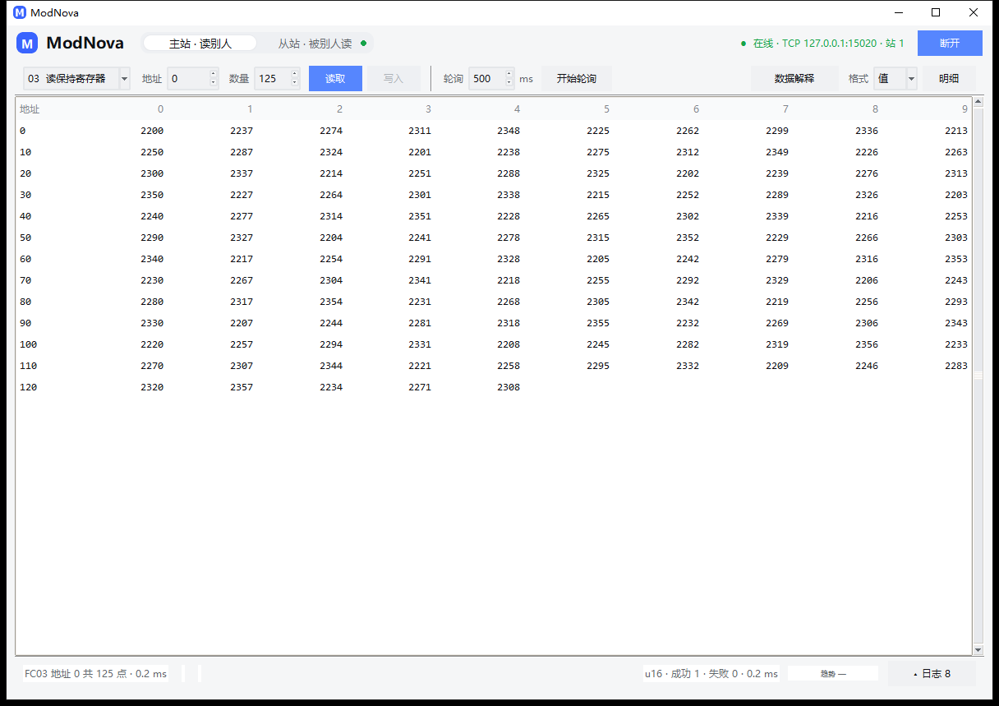
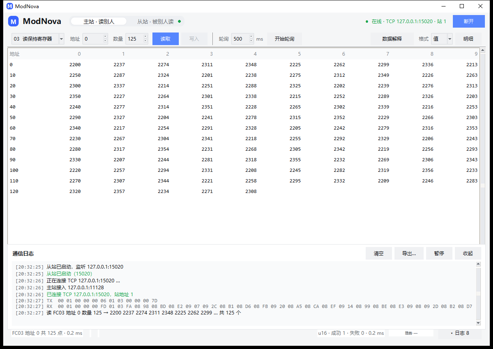
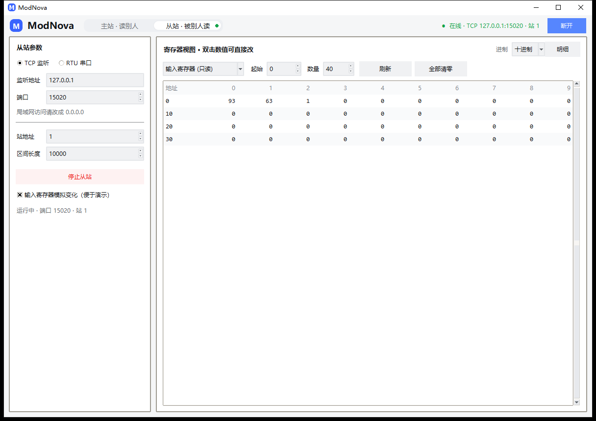

# ModNova

主从一体、TCP / RTU 双模的轻量级 Modbus 调试工具。界面是 Tkinter 单窗口桌面程序，
协议内核只用标准库 —— 只有 RTU 串口模式需要 `pyserial`。

读到的寄存器能按 9 种数据类型（含 ASCII 字符串）× 4 种字节序解释，带缩放、单位和
PLC 地址记法；每次收发的原始报文都能看到。这两件事决定了它能不能当日常主力工具用。



## 能力一览

| 功能码 | 名称 | 主站 | 从站 |
|---|---|---|---|
| 01 | 读线圈 | ✅ | ✅ |
| 02 | 读离散输入 | ✅ | ✅ |
| 03 | 读保持寄存器 | ✅ | ✅ |
| 04 | 读输入寄存器 | ✅ | ✅ |
| 05 | 写单线圈 | ✅ | ✅ |
| 06 | 写单寄存器 | ✅ | ✅ |
| 0F | 写多线圈 | ✅ | ✅ |
| 10 | 写多寄存器 | ✅ | ✅ |
| 17 | 读写多寄存器 | 内核支持 | ✅ |
| 2B | 读设备标识 | 内核支持（TCP / RTU） | ✅ |

异常码按规范生成与解析，主站收到异常会原样上报，不会当成「读到 0」。界面里把异常码
翻成人话（「地址或数量超出从站范围」），不用去查表。

## 数据类型与地址

寄存器只有 16 位无符号整数，但设备里装的常常是别的东西：

| 类型 | 占用 | 说明 |
|---|---|---|
| `uint16` / `int16` | 1 寄存器 | 默认，最常用 |
| `uint32` / `int32` | 2 寄存器 | 累计量、电度 |
| `float32` | 2 寄存器 | 温度、功率、流量 —— 现场最常踩坑的地方 |
| `uint64` / `int64` / `float64` | 4 寄存器 | 少见但存在 |
| `ascii` | 1 寄存器 = 2 个字符 | 设备型号、序列号这类字符串 |

**字节序**四种，对应「寄存器之间的字」和「寄存器内部的字节」两级排列：

| | 字节排列 | 典型来源 |
|---|---|---|
| `ABCD` | 00 01 02 03 | 标准大端 |
| `BADC` | 01 00 03 02 | 部分电表 |
| `CDAB` | 02 03 00 01 | 大量 PLC 的默认 |
| `DCBA` | 03 02 01 00 | 完全小端 |

同一个 `220.5`，四种字节序对应四组完全不同的寄存器值。手册说 float32 却读出天文数字，
九成是这里选错了。

几点容易忽略的规则：

- **ASCII** 一个寄存器装两个字符（`0x4142` 就是 `AB`），字节序决定字符先后；不可打印
  字节显示成 `·`（不用句点，避免和真字符混淆）。写入时填整串，奇数长度自动补 `0x00`，
  非 ASCII 字符会被拒绝而不是写成问号。
- **负数**按补码存（`-5` = `0xFFFB`）。读负数要把类型选成 `int16 / int32`，写入也一样；
  配 `uint16` 会明确提示，不会静默写错。
- **缩放**：`显示值 = 原始值 × 系数`，读的时候乘，写的时候自动除回去。
- **地址记法**：协议地址从 0 开始，PLC 地址从 40001 开始（手册一般写后者）。勾上
  「PLC 地址」直接填 40001 即可；地址填错区域会直接报错。

## 界面

主站页只有三样东西：**一条工具条、一张铺满的表格、一条状态栏**。连接参数只在没连上时
展开；「数据解释」（类型/字节序/系数/单位 + 地址记法）收进弹层，当前解释在状态栏常驻
回声（`u16 · CDAB · ×0.1 ℃`）；「格式」在 值 / HEX / BIN 之间切换。日志收起成状态栏
右侧一个按钮（`▴ 日志`），点开是覆盖在表格底部的浮层 —— 高度不变，表格不缩。



常用操作：

- **读**：选功能码、起始地址、数量 → 「读取」。结果默认是 Modbus Poll 式网格，
  行首总是对齐到每行格数的整数倍，所以「行首地址 + 列头 = 格子地址」；点「明细」切逐行
  视图。鼠标扫过任意格子，状态栏实时给出 `7 = 2215`。
- **写（FC16 最容易搞混的地方）**：`填了几个值` ≠ `写了几个寄存器` —— float32 占 2 个、
  float64 占 4 个。工具条的值框后面、状态栏、表格高亮（写过的格子框起来 2.6 秒）、
  报文日志四个地方都会告诉你是几个。写完自动用对应的读功能码回读确认数据真的落到了
  从站，而不只是「发送成功」。
- **就地改**：双击表格里的任意数值直接改，写的就是这个格子对应的地址，回车发出、
  Esc 取消；跨两个寄存器的类型改一格写整段。线圈双击是取反，只读区域会直接告诉你。
- **从站改**：从站页双击「值」改模拟器内存，负数直接填。
- **看变化**：轮询时值变化的行淡蓝高亮 900ms；点住任意一格，状态栏的迷你趋势条画这格
  最近 120 次读数。统计（`成功 128 · 失败 3 · 0.8 ms`）常驻状态栏，失败数包含重试。
- **链路状态**：顶栏是 `● 在线 · TCP 127.0.0.1:15020 · 站 1`；连续读失败变
  `● 无响应 N 次`，三次以上转 `● 链路中断`，读到一次自动回绿。
- **模拟器**：从站页起一个 TCP / RTU 从站，主站连过来自测，全程不需要真实设备。



### 快捷键

| 键 | 作用 |
|---|---|
| `F5` / `Ctrl+Enter` | 按当前功能码执行一次（读或写） |
| `Ctrl+1` / `Ctrl+2` / `F6` | 主站页 / 从站页 / 两页来回切 |
| `Esc` | 停止轮询 |
| `Ctrl+L` | 清空日志 |
| 右键 | 复制该格 / 复制整表（TSV，可直接粘进 Excel） |
| 双击数值 | 就地改写这个寄存器（回车提交，Esc 取消） |

## 运行

需要 Python 3.9 以上；RTU 模式需要 `pip install pyserial`（或 `pip install -e ".[rtu]"`）。

```bash
run_tk.bat                 # 双击启动（自动找一个带 tkinter 的解释器）
python modnova.py          # 同上
python modnova.py read --tcp 192.168.1.10 --fc 3 --addr 0 --count 4 \
    --type float32 --byteorder CDAB --unit-label ℃
python modnova.py read --tcp 192.168.1.10 --fc 3 --addr 40001 --count 4 --plc
python modnova.py serve --tcp 0.0.0.0:5020 --unit 1 --init 100,200,300

# 装了包之后也可以直接用命令名
pip install -e ".[rtu]"
modnova ports
```

`run_tk.bat` 按顺序探测：`MODNOVA_PYTHON` → uv 装的 `cpython-*` → PATH（跳过微软商店
占位符）→ `py`；找不到会停住并打印提示。

## 目录结构

```
ModNova/
├── modnova.py                统一入口（默认界面 / CLI）
├── run_tk.bat                启动器（自动找带 tkinter 的解释器）
├── modbus_tool/
│   ├── crc.py                CRC16（查表法）
│   ├── pdu.py                功能码编解码 + 数量上限表，与传输无关
│   ├── codec.py              寄存器值 ↔ 物理量（9 类型 × 4 字节序 + 缩放）、hex/bin 格式化
│   ├── addressing.py         协议地址 ↔ PLC 地址，统一的地址解析/显示
│   ├── parsing.py            用户输入解析（全角归一化、整数进制、写值切分）
│   ├── datastore.py          从站四个寄存器区 + 数据源信号
│   ├── transport.py          TCP(MBAP) / RTU(CRC) 链路，带报文探针
│   ├── client.py             主站
│   ├── server.py             从站（协议核心 + 故障注入 + 设备标识）
│   ├── core.py               应用层 API：字段视图、轮询任务、信号、故障、CSV、设备识别
│   ├── view.py               字段级视图（偏移/类型/别名/单位）
│   ├── config.py             配置持久化与预设
│   ├── cli.py                命令行
│   └── gui.py                Tkinter 界面
├── pyproject.toml            打包元数据 + 可选依赖 [rtu]、lint/类型检查配置
└── tests/                    184 项逻辑（unittest）+ 75 项界面 + 9 项 RTU（脚本）
```

## 分层

```
    gui.py (Tk)      cli.py      core.py（应用层 API / 无界面场景）
        │              │              │
        └──────────────┴──────┬───────┘
                              │
                  ┌───────────┴───────────┐
                  │  client.py  server.py │  主站读写语义 / 从站请求分发
                  └───────────┬───────────┘
                  ┌───────────┴───────────┐
                  │        pdu.py         │  功能码 → 字节，不含地址/CRC/MBAP
                  └──────────┬────────────┘
            ┌────────────────┴────────────────┐
       ┌────┴─────┐                     ┌─────┴─────┐
       │ MBAP+TCP │                     │ 地址+CRC  │
       └──────────┘                     └───────────┘

    横切层（不碰字节流，界面/命令行/应用层共用）：
      codec.py / addressing.py / parsing.py / view.py / config.py
```

关键点：**PDU 层不含站地址、不含 CRC、不含 MBAP 头**，外壳全部由传输层负责 ——
换传输方式不用碰协议逻辑，单元测试直接给 `ModbusServer.handle_pdu()` 喂字节就行。

界面与 CLI 直接使用 `client/server` + 横切层；`core.py` 是「无界面 API」，字段视图、
多任务轮询、CSV 记录、故障注入、FC 0x2B 设备识别等能力在其中实现且有测试覆盖，
但 Tk 界面还没有对应入口。用法：

```python
from modbus_tool import ModbusCore
app = ModbusCore()
app.connect({"mode": "tcp", "host": "192.168.1.10", "port": 502, "unit": 1})
print(app.read(3, 0, 4, dtype="float32", byteorder="CDAB")["rows"])
```

## 几个设计决定

**TCP 粘包按 MBAP 的 length 字段切帧** —— 先读 7 字节头，再精确读 `length-1` 字节，
几个响应叠在一个 `recv` 里也不会错位。

**RTU 不用 3.5 字符静默判帧，按功能码推算帧长** —— 3.5 字符间隔在 PC 上靠不住
（USB 转串口抖动动辄几十毫秒）；拿到站地址和功能码后整帧长度唯一确定。

**重试只针对超时和链路错误** —— 从站回了 `ILLEGAL_DATA_ADDRESS`，那是答案不是故障。
读请求在链路断了时会自动重连重试一次；**写请求不重试**，重发可能写两遍。

**从站越界返回异常码，不返回 0** —— 悄悄补零会让调试时算错的地址看不出来。

## 测试

```bash
python tests/run_all.py          # 一条命令跑完三套（逻辑 + 界面 + RTU）

python -m unittest discover -s tests -v        # 逻辑 184 项
"<带 tkinter 的 python>" tests/ui_full_test.py  # 界面 75 项
"<带 pyserial 的 python>" tests/rtu_full_test.py  # RTU 9 项（没有 pyserial 可用桩）
```

逻辑测试分五个文件：协议、类型与地址、应用层（真起从站走完整链路）、新能力、
回归（`test_regressions.py`，锁住每次审查修掉的具体缺陷）。界面测试按「用户会做的
每个动作」跑，每条用例同时断言界面文字、日志内容和从站内存里的真实值。

## 常见问题

**502 端口起不来。** 502 常被其他 Modbus 软件占用；Linux 上还需要 root。
模拟器默认用 5020，客户端跟着改即可。

**从站默认只听 127.0.0.1。** Modbus 没有鉴权，绑 `0.0.0.0` 等于把一块可读写的内存放到
整个网段上。要给局域网设备连，把「监听地址」改成 `0.0.0.0`（同时最多 8 条连接）。

**串口打不开。** 多半被别的程序占用，关掉对方再试。RTU 需要 `pip install pyserial`，
TCP 不需要。老仪表如果是 7 数据位（7E1），在链路卡里把「数据位」改成 7。

**写负数提示「超出范围」。** 当前类型是无符号的，把类型改成 `int16 / int32`，
或按补码填 `65531`。从站模拟器直接填 `-5` 就行。

**读到的值和设备手册对不上。** 先确认协议地址 / PLC 地址的换算（手册里的 40001 通常
对应协议地址 0），再确认字节序 —— float32 尤其容易选错。

**顶栏显示「无响应」。** 请求发出去了但没回。看日志里 TX 有没有出去、RX 有没有回来：
只有 TX 是站号/接线/串口参数问题；TX/RX 都有但报 CRC 错是波特率或干扰问题。
